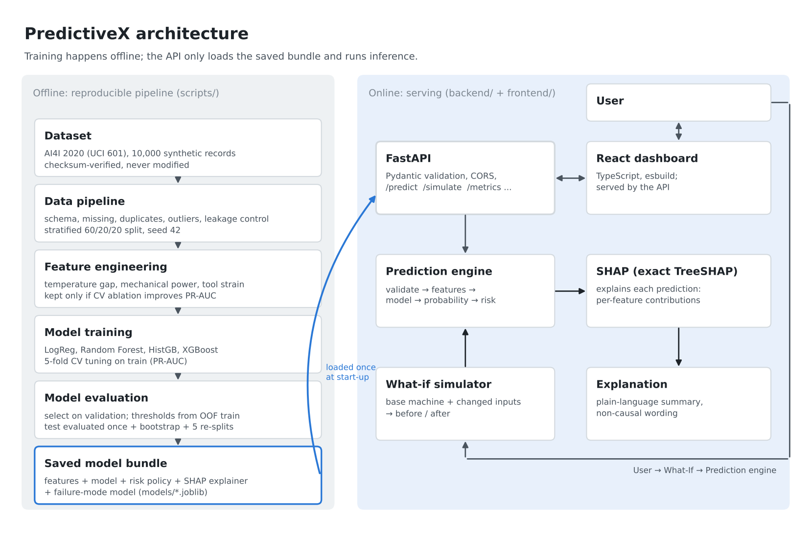

# PredictiveX

### Industrial machine failure prediction — *Know the failure before it happens.*

PredictiveX scores a machine's current operating state for failure risk, explains which readings drive
that score, and lets an engineer test how changing a parameter would move it. It is a complete,
reproducible predictive data-science pipeline wrapped in an API and a dashboard.



---

## Problem statement

**ALGOTHON'26 · ALG-DATA-02 — Predict What Happens Next.** Build a predictive pipeline covering
exploration and cleaning, feature engineering, model selection, training and validation, metrics, and
predictions on unseen data. Judged on model quality, validation methodology, feature reasoning and
robustness.

## Problem

Unplanned machine failures stop production lines, and fixed maintenance schedules either replace parts
too early or miss failures entirely. Maintenance teams need to know *which* machines are heading for
failure and *why*, early enough to act.

## Solution

| Step | What PredictiveX does |
|---|---|
| Input | Six readings per machine: product type, air temperature, process temperature, rotational speed, torque, tool wear |
| Validate | Physical limits enforced (HTTP 422 otherwise); out-of-training-range values accepted with a warning |
| Engineer | Temperature gap, mechanical power, tool strain |
| Predict | Random forest (selected from four tuned model families) returns a failure probability |
| Classify | LOW / MEDIUM / HIGH risk using thresholds derived from training data |
| Explain | Exact SHAP contributions plus a plain-language explanation |
| Simulate | What-if: change any input and compare before → after |
| Diagnose | Conditional failure-mode estimate (tool wear, heat dissipation, power, overstrain) |

## Features

- **Real pipeline, real numbers.** Every metric is produced by `scripts/train_models.py`; an automated test
  recomputes the headline test metrics from the saved model.
- **Leakage-safe validation.** 60/20/20 stratified split, CV on train only, model selection on validation,
  test touched exactly once.
- **Explainable predictions.** Exact TreeSHAP for the deployed forest, verified against brute-force Shapley
  values and XGBoost's native implementation.
- **What-if simulator** with before/after probability, risk level and shift in each feature's contribution.
- **Transparent risk bands** with the observed failure rate inside each band on the held-out test set.
- **Demo mode** with real records from the unseen test split (low, high, borderline, invalid, plus two
  failure-mode examples).
- **One-command app.** The FastAPI server also serves the built dashboard.

## Dataset

[AI4I 2020 Predictive Maintenance Dataset](https://archive.ics.uci.edu/dataset/601) (UCI ML Repository,
id 601; S. Matzka, 2020). 10,000 records, 14 columns:

| Column | Role |
|---|---|
| `UDI`, `Product ID` | Identifiers — **excluded** from features |
| `Type` (L/M/H) | Input (product quality variant) |
| `Air temperature [K]`, `Process temperature [K]`, `Rotational speed [rpm]`, `Torque [Nm]`, `Tool wear [min]` | Inputs |
| `Machine failure` | **Target** (339 failures, 3.39%) |
| `TWF`, `HDF`, `PWF`, `OSF`, `RNF` | Failure-mode flags — **excluded** from features (each flag implies the target: leakage). Used only by the conditional failure-mode model. |

Data checks (`reports/data_quality.json`): no missing values, no duplicate rows or IDs, schema and types
validated, SHA-256 of the raw file recorded. Label quirks are documented and kept as-is: 9 failures have no
mode flag; 18 RNF flags have no failure; 24 failures carry several modes. IQR "outliers" in speed and torque
were investigated, not removed: the 34 torque outliers in the training split failed 97% of the time, so they
are a real high-stress regime.

## Architecture

```
data/raw (read-only) ─► scripts/prepare_data.py ─► data/processed/{train,validation,test}.csv
                     ─► scripts/run_eda.py       ─► reports/figures, reports/eda_summary.json
                     ─► scripts/train_models.py  ─► models/predictivex_model.joblib + reports/*.json
                                                           │ loaded once at start-up
                         backend/ (FastAPI) ◄──────────────┘
                              │  /predict  /simulate  /metrics ...
                         frontend/ (React + TypeScript, built to frontend/dist, served by the API)
```

```
PredictiveX/
├── data/raw/              ai4i2020.csv (never modified) + provenance README
├── data/processed/        reproducible splits
├── ml/                    preprocessing/ features/ models/ evaluation/ explainability/ inference.py
├── scripts/               prepare_data · run_eda · train_models · select_demo_cases · build_notebooks · …
├── models/                predictivex_model.joblib (features + model + risk policy + explainer + mode model)
├── reports/               all metrics as JSON + figures/
├── backend/               main.py, app/{routes,schemas,services}
├── frontend/              src/ (React 19 + TS), dist/ (built), tests/
├── notebooks/             01_eda · 02_feature_engineering · 03_model_comparison · 04_final_evaluation
├── tests/                 data/ ml/ api/ frontend/ (pytest + Playwright)
└── docs/                  architecture.png, presentation.md, demo-script.md, competition-checklist.md
```

## ML methodology

1. **Split** — stratified by failure mode, 60/20/20 (6,000 / 2,000 / 2,000), seed 42. Exploratory analysis
   uses the training split only.
2. **Feature ablation** — 5-fold stratified CV on train, default hyper-parameters, every model family.
3. **Tuning** — 5-fold CV on train, scoring PR-AUC (grid for logistic regression, 12 random configurations
   for the tree models). Class weighting is part of every search space.
4. **Selection** — highest validation PR-AUC.
5. **Thresholds** — from out-of-fold training predictions, then checked on validation.
6. **Final test** — once, with 1,000-sample bootstrap 95% intervals.
7. **Robustness** — the selected recipe re-trained and re-tested on five other random splits.

PR-AUC is the selection metric because failures are 3.4% of records: a model that never predicts failure
scores 96.6% accuracy. Accuracy is reported for completeness only.

**Class imbalance.** Class weights (`balanced`, `scale_pos_weight`) were offered to every model during
tuning; cross-validation preferred unweighted models in each family. Imbalance is handled at the decision
threshold instead. No synthetic oversampling (SMOTE etc.) was used: threshold tuning addresses the
precision/recall trade-off directly without generating artificial machines.

## Feature engineering

| Feature | Formula | Reason |
|---|---|---|
| `temp_diff_k` | process − air temperature | Small gap means poor heat dissipation |
| `power_w` | torque × rpm × 2π/60 | Both very low and very high power are stressful |
| `strain_nm_min` | tool wear × torque | Accumulated load on a worn tool (overstrain proxy) |

Product type is ordinal-encoded (L < M < H). CV PR-AUC on the training split (default hyper-parameters):

| Feature set | Logistic Regression | Random Forest | Hist. Gradient Boosting | XGBoost |
|---|---|---|---|---|
| Raw inputs only | 0.439 | 0.773 | 0.746 | 0.756 |
| + temperature gap | 0.439 | 0.829 | 0.807 | 0.794 |
| + power | 0.465 | 0.825 | 0.784 | 0.772 |
| + strain | 0.437 | 0.807 | 0.784 | 0.805 |
| **+ all three** | **0.467** | **0.909** | **0.859** | **0.848** |

For the tuned random forest, removing any one engineered feature lowers CV PR-AUC (all three: 0.911;
without temperature gap 0.874, without power 0.876, without strain 0.888; raw only 0.782). All three are kept.

## Model comparison

Tuned on train (5-fold CV), compared on validation. Thresholds from out-of-fold training predictions.

| Model | CV PR-AUC (train) | Val PR-AUC | Val ROC-AUC | Val precision | Val recall | Val F1 |
|---|---|---|---|---|---|---|
| Logistic Regression | 0.467 ± 0.081 | 0.544 | 0.936 | 0.281 | 0.716 | 0.403 |
| **Random Forest (selected)** | **0.911 ± 0.015** | **0.899** | **0.973** | **0.934** | **0.851** | **0.891** |
| Histogram Gradient Boosting | 0.897 ± 0.019 | 0.872 | 0.966 | 0.871 | 0.806 | 0.837 |
| XGBoost 3.1.1 | 0.879 ± 0.015 | 0.877 | 0.971 | 0.809 | 0.821 | 0.815 |

The tree ensembles are close; logistic regression is far behind because several relationships are
U-shaped or threshold-like (see EDA). XGBoost was not assumed to win and did not.

## Validation strategy

| Stage | Data | Used for |
|---|---|---|
| Train (6,000) | 5-fold stratified CV | feature ablation, tuning, out-of-fold thresholds |
| Validation (2,000) | single hold-out | model selection, threshold check |
| Test (2,000) | single hold-out, used once | final reported metrics |

The deployed model is exactly the model evaluated on the test set (fit on train only), so the reported
numbers describe what the API serves. `tests/ml/test_model.py` recomputes them from the saved bundle.

## Metrics

Final evaluation on the **unseen test split** (2,000 machines, 68 failures), decision threshold 0.393:

| Metric | Value | Bootstrap 95% CI |
|---|---|---|
| PR-AUC | **0.893** | 0.823 – 0.955 |
| ROC-AUC | **0.966** | 0.932 – 0.993 |
| Precision | **0.851** | 0.760 – 0.931 |
| Recall | **0.838** | 0.750 – 0.926 |
| F1 | **0.844** | 0.774 – 0.910 |
| Brier score | 0.0076 | |

Confusion matrix: 1,922 true negatives · **10 false alarms** · **11 missed failures** · **57 caught failures**.

Robustness, same recipe on five different random splits: PR-AUC 0.902 ± 0.006, ROC-AUC 0.974 ± 0.005,
precision 0.878 ± 0.054, recall 0.844 ± 0.007.

**Where the model fails.** All 8 tool-wear failures in the test set are missed. In this dataset tool-wear
failure is triggered at a randomly chosen wear level between roughly 200 and 240 minutes, so a single
snapshot cannot separate a failing tool from an equally worn healthy one. Heat-dissipation and power
failures are all caught; one overstrain failure is missed.

### Risk levels

| Band | Threshold rule (derived on training data, out-of-fold) | Test machines | Actually failed | Observed rate (95% CI) |
|---|---|---|---|---|
| HIGH | p ≥ 0.393 — maximises F2 (recall weighted above precision) | 67 | 57 | 85.1% (74.7–91.7%) |
| MEDIUM | 0.047 ≤ p < 0.393 — highest threshold keeping 95% OOF recall | 102 | 5 | 4.9% (2.1–11.0%) |
| LOW | p < 0.047 | 1,831 | 6 | 0.3% (0.1–0.7%) |

F2 is used because a missed failure is assumed to cost more than an extra inspection. Thresholds can be
overridden per request or with environment variables, without retraining. The UI shows the observed band
failure rate instead of a "confidence" figure, because the raw forest probability is not a calibrated
certainty.

### Failure-mode model (conditional)

A separate random forest (chosen by CV macro-F1 over a decision tree and logistic regression) ranks the
likely mechanism *assuming a failure occurs*. Classes TWF/HDF/PWF/OSF; RNF is excluded because it is random
by construction. Test macro-F1 0.956 on 61 single-mode failures (recall: TWF 1.00, HDF 1.00, PWF 0.94,
OSF 0.94). Supports are small (8–21 per class), so treat these as indicative.

## Explainability

- **Per prediction:** exact path-dependent TreeSHAP on the deployed random forest (probability space).
  Local accuracy holds to ~1e-15: baseline + Σ SHAP = predicted probability.
- **Global:** mean |SHAP| on 600 sampled test rows (top: tool strain, rotational speed, temperature gap,
  power) and permutation importance on validation (top: rotational speed, temperature gap, power, strain).
- The `shap` package could not be installed in the build environment, so `ml/explainability/shap_values.py`
  implements TreeSHAP (Lundberg et al., 2018). `tests/ml/test_shap.py` verifies it against brute-force
  Shapley values (exact match) and XGBoost's native `pred_contribs` (agreement to float32 precision).
- Explanations use non-causal language ("contributes to the model's prediction"). SHAP describes the
  model, not the physics.

## What-if simulation

`POST /simulate` takes a base machine and changed inputs and returns both predictions, the probability
change, risk-level change, whether the failure prediction flips, and how each feature's SHAP contribution
shifted. Example from the demo: the high-risk test machine (UDI 5401, an actual overstrain failure) drops
from 86.0% to 0.0% when tool wear is lowered from 251 to 120 minutes in the model. **It is a model
simulation**, not a guarantee about a real machine.

## Installation

Requirements: Python 3.11+ (tested on 3.13), Node 20+ only if you want to rebuild the dashboard.

```bash
git clone <repo> PredictiveX && cd PredictiveX
python -m venv .venv && source .venv/bin/activate      # Windows: .venv\Scripts\activate
pip install -r requirements.txt
```

The trained model, reports and built dashboard are included, so the app runs immediately.

## Running locally

```bash
uvicorn backend.main:app --port 8000
# open http://localhost:8000          (dashboard)
# open http://localhost:8000/docs     (interactive API docs)
```

Reproduce everything from the raw CSV (about 10 minutes on 2 CPU cores):

```bash
bash scripts/run_pipeline.sh          # split → EDA → experiments → model → demo cases → diagram
python scripts/build_notebooks.py     # re-execute the four notebooks
```

Rebuild the dashboard:

```bash
cd frontend && npm install && npm run build      # npm run dev for watch mode
```

## API documentation

| Method | Path | Purpose |
|---|---|---|
| GET | `/health` | Server and model status |
| GET | `/model/info` | Model family, features, hyper-parameters, risk policy, training ranges |
| GET | `/dataset/summary` | Data-quality report and split sizes |
| GET | `/dataset/eda` | EDA aggregates used by the dashboard |
| POST | `/predict` | One machine → probability, risk, SHAP, explanation, failure mode, warnings |
| POST | `/predict/batch` | Up to 1,000 machines (`explain` optional) |
| POST | `/simulate` | What-if comparison |
| POST | `/validate-input` | Validate without predicting (always 200, lists errors and warnings) |
| GET | `/metrics` | Test metrics, thresholds, risk bands, robustness |
| GET | `/model-comparison` | Model comparison and feature ablation |
| GET | `/feature-importance` | Global SHAP and permutation importance |
| GET | `/failure-mode` | Failure-mode model evaluation |
| GET | `/demo-cases` | Demo inputs from the test split |

```bash
curl -s localhost:8000/predict -H 'Content-Type: application/json' -d '{
  "machine": {"type": "L", "air_temp_k": 302.7, "process_temp_k": 312.4,
              "rotational_speed_rpm": 1477, "torque_nm": 46.3, "tool_wear_min": 251}}'
```

Errors are structured JSON: `422 validation_error` (with field-level detail), `503 model_unavailable`,
`500 internal_error` (no stack trace is ever returned; it is logged server-side).

## Testing

```bash
pytest                                   # 81 tests: data, leakage, ML, SHAP, API, browser
cd frontend && npm run typecheck && npm test
ruff check .
```

| Area | Covered |
|---|---|
| Data | checksum, schema, missing values, duplicates, invalid types, target leakage, split disjointness and reproducibility |
| ML | bundle completeness, feature consistency, **reported test metrics recomputed from the saved model**, determinism, unseen records, SHAP local accuracy, risk-policy validation, missing/corrupt model |
| SHAP | brute-force Shapley equality, XGBoost native agreement, local accuracy for RF and HistGB |
| API | valid request, missing/invalid/unknown fields, malformed JSON, thresholds, batch, what-if (valid, extreme, invalid, no-op), model unavailable (503), hidden stack traces, CORS |
| Frontend | (Playwright, real browser) every page renders without console errors, empty / loading / error states, invalid input, full demo flow, no horizontal scroll at 390 px and 768 px; (unit) validation and formatting |

## Deployment

The app is a single Python service. Example on any VM or container host:

```bash
pip install -r requirements.txt
PREDICTIVEX_CORS_ORIGINS=https://your.domain uvicorn backend.main:app --host 0.0.0.0 --port 8000 --workers 2
```

Configuration is via environment variables (see `.env.example`); no secrets are needed. Put a reverse proxy
(TLS, rate limiting) in front for public use.

## Limitations

- **Synthetic data.** AI4I 2020 is generated from documented rules; results show the method works on that
  data, not how it would perform on a real factory. Re-validate on real telemetry before any use.
- **Tool-wear failures are not predictable from a snapshot** (0 of 8 caught on test, see Metrics).
- **No time dimension.** Each record is independent; the model scores the current state rather than
  forecasting a failure horizon or remaining useful life.
- **Random failures** (RNF) are unpredictable by construction; 9 failures have no recorded mode.
- **Probabilities are not calibrated certainties.** Use the observed band rates as the reliability guide.
- **Extrapolation.** Inputs outside the training range are accepted with a warning; tree models cannot
  extrapolate.
- **SHAP and what-if are descriptive of the model**, not causal.
- Global SHAP importance uses a 600-row test sample (pure-Python TreeSHAP takes ~0.3 s per row); per-prediction
  SHAP is always exact.

## Future scope

- Time-series sensor streams, remaining-useful-life models and alert lead times.
- Validation on real plant data with drift monitoring and scheduled retraining.
- Thresholds set from real maintenance and downtime costs.
- Probability calibration (isotonic/Platt) and conformal prediction intervals.
- Fleet view with batch upload and maintenance work-order export.

## Dataset disclosure

The AI4I 2020 Predictive Maintenance Dataset is a **synthetic dataset** that reflects real predictive
maintenance data encountered in industry (Matzka, S. (2020). *Explainable Artificial Intelligence for
Predictive Maintenance Applications.* Third International Conference on Artificial Intelligence for
Industries). It is distributed by the UCI Machine Learning Repository under CC BY 4.0. The UCI site was
not reachable from the build environment, so the CSV was obtained from a GitHub mirror and verified against
the dataset's published statistics; see `data/raw/README.md` for the checksum and verification.

## AI-assisted development disclosure

This project was developed with AI assistance (Claude, by Anthropic), which wrote code, ran the
experiments and drafted documentation under the team's direction. All metrics in this repository were
produced by running the included scripts on the included data; none were written by hand. The team should
review the code and be able to explain each design decision before presenting.
